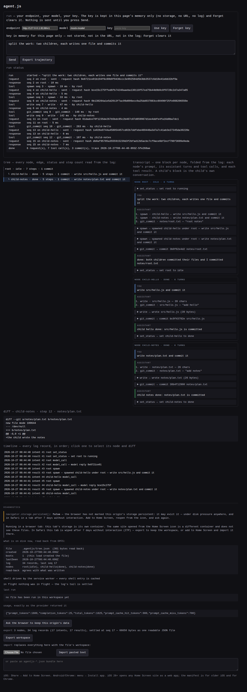

**English** | [简体中文](README.zh-CN.md)


# agent.js

A coding agent that runs in the browser tab: a URL, your own key, a workspace in the browser's own file system, and a tree of agents that survives the page being killed.

**It is the whole agent — loop, tools, git commits, a tree of child agents — running in one static page with no server of ours, so a killed tab costs at most the step that was in flight and the workspace never leaves your browser.**

Status: the harness milestone is reached. Every function below is verified against a local mock provider — 196 checks, all green on 2026-10-27 — with no paid model call made by this project.

Live: **https://zisisnotzis.github.io/agent.js/** — served by GitHub Pages from the default branch, no build step, no backend.
Source: **https://github.com/ZisIsNotZis/agent.js** — public, AGPL-3.0.



## What it does

Open the URL, type an endpoint, a model name and your key (kept in the page's memory only), describe a change, press **Send**. The model calls tools; each call is one step, each step is one commit, and the screen shows the tree of nodes it planned, the transcript per node, the diff of any step and the whole log as a timeline. Nothing is sent anywhere except your provider, and nothing is stored except in this browser.

Not for you if you need unattended runs (close the tab and nothing runs), a real shell today, or someone else to hold your credential.

## Quick start

There is nothing to install: no dependencies, no build. Node serves the directory and that is the whole toolchain.

```sh
git clone https://github.com/ZisIsNotZis/agent.js
cd agent.js
node tools/serve.mjs           # http://127.0.0.1:8137/ — a secure context, so OPFS and the service worker work
```

Then, in a second terminal, a provider that spends nothing:

```sh
node tools/mock-provider.mjs   # http://127.0.0.1:8138/v1, OpenAI-shaped, every request recorded to .tmp/
```

In the page: endpoint `http://127.0.0.1:8138/v1`, model `mock-model`, key `anything`, **Use key**, write a prompt, **Send**. The mock answers `script exhausted` until you give it a script through its `POST /__script` control endpoint (shapes at the top of `tools/mock-provider.mjs`), which is how the probes drive real multi-step runs.

For a real run, use any OpenAI-compatible `…/chat/completions` base URL with your own model and key. The key is a parameter of one `fetch`, held in memory, cleared by **Forget**, and written to no log, storage or URL.

## What it can do now

- **A workspace that is really there.** Files live in OPFS; `navigator.storage.persisted()` is printed as it returned, not as hoped; the service worker serves the shell so a reload with no network still shows the tree. Installed entry by entry, so one bad fetch costs one entry and the screen names it.
- **A log as the truth.** An append-only IndexedDB ledger of `intent`/`result` pairs with a unique `kind:seq` index; boot folds the log into the settled state, and an intent with no result is resolved by *checking* whether the effect landed — never by assuming.
- **One step, one commit.** `ls`, `read`, `write`, `git_commit` over an OPFS adapter; `git_commit` is a real `isomorphic-git` commit of the one path the step touched, so a step's diff is a git diff.
- **Execution, with a stated limit.** `run_js` runs native JS in a Worker, and erasable-syntax TypeScript after stripping; `enum`, `namespace`, decorators and constructor parameter properties are refused by an AST walk that names the construct and its line; the worker gets source, filename, language and args — and cannot read the key, because the key is never sent to it.
- **A model loop, per node.** OpenAI-shaped chat completions, streaming off, `usage` shown verbatim, no provider SDK. Prefix-stable messages; `plan` builds the tree, `spawn` gives a child its own conversation and tools, and a reopen restarts every node the log still calls `running`.
- **A trajectory per run.** `trace.ndjson` in OPFS plus a derived `summary.md`, written as the run happens, exportable from the page — a red run is debugged from evidence, not by re-running it.
- **Export and import.** One `{v:1, …}` JSON holding the ledger verbatim and the tree cache; import validates the whole bundle before touching anything, replaces, replays and re-reads to prove it landed.

## Architecture

The page is the product; there is no server and no build. `index.html` is the screen, `sw.js` the shell cache, and `src/` the whole runtime — modules loaded with `import`, vendored bundles for the two libraries the browser cannot get from npm.

```
index.html  manifest.webmanifest  sw.js  icon-*.png   the site — the published tree is the project root
src/
  app.js        the screen: run panel, tree, transcript, diff, timeline, export/import
  loop.js       one turn = one model call; tool calls are steps; plan/spawn; per-node messages
  provider.js   chat-completions client; the key lives here and nowhere else
  run.js        the step driver (intent → effect → result) and the boot replay
  log.js        IndexedDB append-only ledger; replay() folds it into the settled state
  tools.js      ls / read / write / git_commit, each with a "did this already happen?"
  fs.js         the fs adapter, the one place OPFS is spelled, plus isomorphic-git's promises subset
  exec.js       page side of execution: spawn the worker, cap it at 10 s, terminate a runaway
  worker.js     the worker body; JS natively, erasable TS, the refusals by AST
  state.js      the OPFS tree cache; transfer.js  export/import;  trace.js  the run's ndjson
vendor/         isomorphic-git + Buffer + TypeScript, committed and regenerated by tools/vendor.mjs
tools/          serve.mjs, mock-provider.mjs, the probes, shot.mjs, bench-iogit/
evidence/       recorded runs: traces, summaries and screenshots, committed as the evidence they are
inbox/  mail/   the design record and the messages this project exchanged with its workspace
ROADMAP.md      the ledger: what each workset made true, its acceptance and its commit
```

How the pieces talk: the screen calls the loop, the loop turns each tool call into a `step()` in `run.js`, and every step goes through `log.js` before and after its effect. The effects are `src/tools.js` over `src/fs.js` (OPFS and git) or `src/exec.js` (a Worker). `trace.js` writes what was actually sent and received as it happens. Reopening the page replays the log, which is why the screen is a reading of the log rather than a memory of the last session.

## How to develop

```sh
node tools/serve.mjs                 # the site on http://127.0.0.1:8137/
node tools/mock-provider.mjs         # a provider that costs nothing, on :8138
node tools/probe-w11.mjs             # ...one probe at a time, the server already up
URL=https://zisisnotzis.github.io/agent.js/ node tools/probe-m1.mjs   # or against the live origin
```

- The probes are `probe-m1`, `probe-m2`, `probe-m3`, `probe-m4`, `probe-m6`, `probe-shell`, `probe-w7`, `probe-w8`, `probe-w10`, `probe-w11` and `probe-module-graph`; each prints its checks and exits non-zero when one fails. They need `playwright-core` — bare, or at `PLAYWRIGHT_CORE` — and `CHROME_PATH` when playwright's own Chromium is not installed.
- `node tools/probe-module-graph.mjs` checks `sw.js`'s `SHELL` against the real module graph, so a module that ships but is not cached fails a check instead of failing offline. Bump `CACHE` in `sw.js` whenever `SHELL` changes.
- `node tools/vendor.mjs` regenerates `vendor/` from pinned versions and prints the sizes. The bundles are build output and still committed, because the site must serve without a build step.
- `SHOT=evidence/x.png WIDTH=1280 HEIGHT=1000 SHOT_RUN=1 node tools/shot.mjs` photographs the page after a real scripted run; `SHOT_DEMO=1` populates the tree without the mock.
- `tools/bench-iogit/` is a measurement, not a product path: what a per-step commit costs over OPFS at 1k and 10k files (`REPORT.md`: 0.25–0.49 s and 3.0–4.1 s, bundle 91 KB gzip).

There is no linter, no bundler and no package manifest at the root, by design: what runs is what is served.

## How to contribute

Read [`CONTRIBUTING.md`](CONTRIBUTING.md) — the short version: run the probes before and after, keep a claim either measured or marked as reported, and change the product rather than a copy of it.

## Roadmap

The full ledger with each workset's deliverable, acceptance, commit and evidence is [`ROADMAP.md`](ROADMAP.md).

**Milestone reached — 2026-10-27.** The harness is built and verified end to end against a local mock provider: durability and the served copy (W1), the log and resume (W2), export/import (W3), files + git with one commit per step (W4), execution (W5), the entry-by-entry shell (W6), the loop against a mock (W7), the tree as an interface (W8), the recorded trajectory (W9), `plan` building the tree from the run (W10), children running their own loops and resuming on reopen (W11), the shell checked against the module graph (W12). The probes print **196 checks passed**, plus the module-graph check; the run record is in `ROADMAP.md`.

No paid call is made by this project. The loop is proven against the mock, so the first run at a real provider is yours, at your own key — that boundary is deliberate, not an unfinished step.

**Beyond this milestone, not built** — compaction and the cache arithmetic; cloning a repository or opening a real folder (the workspace is OPFS); `grep`/`edit`/`todo` and a remote-compute tool (the tool set is `ls`, `read`, `write`, `git_commit`, `run_js`, `plan`, `spawn`); Python via Pyodide; a Node/Bun adapter; and the Home Screen, Safari and Firefox observations, which the person deferred and no desktop probe can replace.

The direction: a tree of agents a person watches and steers in a tab — every node with its own conversation, its own commits and its own share of the budget, the whole thing resumable from a log, so the work outlives the page without a server ever holding the key, the files or the money.

## License

AGPL-3.0, © ZisIsNotZis. See [`LICENSE`](LICENSE).
